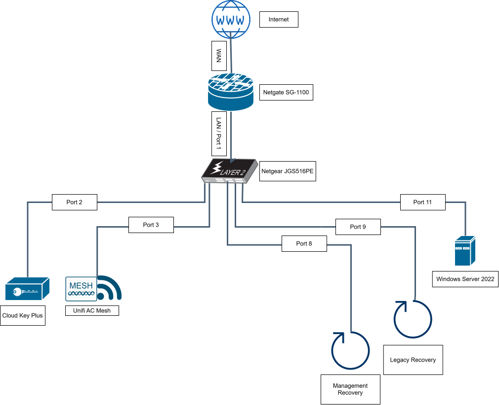

# Home Network Lab

## Overview

This repository documents the design, configuration, validation, recovery procedures, and operational lessons for my segmented home network and personal lab environment.

The network uses VLAN-based Layer 2 segmentation with pfSense providing Layer 3 routing and firewall policy between security zones. A dedicated WireGuard routed security zone provides least-privilege remote administrative access.

## Design Goals

- Separate management, trusted clients, servers, guests, and recovery access.
- Apply least-privilege policy between network segments.
- Maintain reliable administrative and emergency recovery paths.
- Document the environment well enough to support troubleshooting and future changes.
- Use repeatable validation and change-control procedures.

## Hardware

The current environment includes:

- Netgate SG-1100 running pfSense
- Netgear JGS516PE managed switch
- UniFi Cloud Key Plus
- UniFi AC Mesh wireless access point
- Windows Server 2022
- Administrative client systems

## Network Zones

| VLAN | Name | Purpose |
|---|---|---|
| 1 | Legacy / Recovery | Break-glass and recovery access |
| 10 | Management | Infrastructure administration |
| 20 | Trusted | Trusted client devices |
| 30 | Servers | Server workloads |
| 40 | Guest | Isolated guest wireless access |

### Non-VLAN Routed Security Zones

| Zone | Network | Purpose |
|---|---|---|
| WG_REMOTE | `10.10.50.0/24` | Least-privilege WireGuard remote administration |

`WG_REMOTE` is a routed VPN network, not a VLAN. It does not use 802.1Q tagging or switch VLAN membership.

## High-Level Topology

  

VLANs provide Layer 2 segmentation. pfSense enforces routed Layer 3 policy between VLANs. Traffic between devices on the same VLAN may remain entirely at Layer 2 and therefore may not traverse the firewall.

## Documentation

- [Network Architecture](docs/architecture.md)
- [VLAN and Addressing Plan](docs/vlan-addressing.md)
- [Switching and VLAN Transport](docs/switching.md)
- [Firewall Policy](docs/firewall-policy.md)
- [Remote Access VPN](docs/remote-access-vpn.md)
- [Wireless](docs/wireless.md)
- [Recovery and Emergency Access](docs/recovery.md)
- [Network Validation Checklist](docs/validation.md)
- [Troubleshooting Lessons](docs/troubleshooting.md)
- [Adding a New VLAN](docs/adding-a-vlan.md)

## Important Recovery Notes

The network includes dedicated recovery paths for management access.

Recovery interfaces and ports should be preserved during configuration changes until replacement access has been tested successfully.

The Legacy / Recovery VLAN is intentionally more privileged than normal production segments and should be treated as emergency-use infrastructure.

## Repository Scope

This repository contains documentation, sanitized examples, diagrams, and operational history for the lab.

Live configuration backups, credentials, private keys, passwords, tokens, and other sensitive material are intentionally excluded.