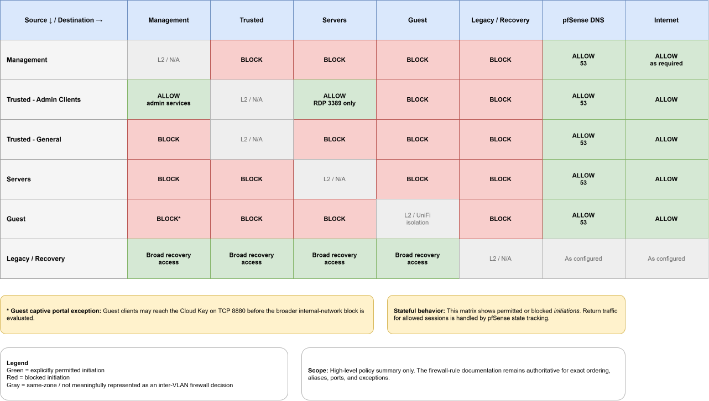

# Firewall Policy

## Purpose

This document defines the intended IPv4 firewall policy enforced by pfSense between the network's security zones.

It describes the trust model, rule-evaluation behavior, important aliases, permitted traffic, blocked traffic, and narrowly defined exceptions.

Historical troubleshooting events and temporary rules are documented separately.

## Policy Model

pfSense acts as the Layer 3 enforcement point for traffic routed between VLANs.

Firewall policy follows a least-privilege approach:

- Permit only the routed access required for the intended role of each VLAN.
- Block unnecessary lateral access between security zones.
- Place specific exceptions above broader deny rules.
- Allow general Internet egress only after protected internal destinations have already been handled.
- Preserve narrowly defined administrative and recovery access paths.

## Rule Evaluation Principles

pfSense evaluates interface firewall rules from top to bottom and applies the first matching rule.

This means rule order is part of the security policy.

Important principles include:

- Place narrow allow rules above broader block rules when a specific exception is required.
- Place internal-network block rules above broad Internet egress rules.
- Remember that rules are evaluated on the interface where traffic enters pfSense.
- Return traffic for an allowed stateful connection is normally permitted automatically.
- Same-VLAN traffic may not traverse pfSense and therefore may not be controlled by these rules.

## Effective Trust Matrix

The following matrix summarizes which zones may initiate traffic toward other zones under the current policy.

  

## Aliases

pfSense aliases are used to group related addresses and networks so that firewall rules can express policy more clearly and can be maintained without editing every rule individually.

### ADMIN_CLIENTS

`ADMIN_CLIENTS` contains the trusted administrative client addresses:

- `10.10.20.10`
- `10.10.20.11`

These addresses are used to identify the Trusted clients that receive narrowly defined administrative exceptions, such as access to Management services and RDP access to the Windows Server.

A source IP address is an operational identifier and should not be treated as strong authentication by itself.

### INTERNAL_NETWORKS

`INTERNAL_NETWORKS` represents the protected internal IPv4 networks used by the firewall policy.

It includes:

- `192.168.1.0/24` - Legacy / Recovery
- `10.10.10.0/24` - Management
- `10.10.20.0/24` - Trusted
- `10.10.30.0/24` - Servers

This alias is used by rules that block lateral access to protected internal networks before broader Internet egress is allowed.

### MANAGEMENT_BLOCKED_NETWORKS

`MANAGEMENT_BLOCKED_NETWORKS` contains the internal networks that Management clients should not initiate connections toward.

It includes:

- `192.168.1.0/24` - Legacy / Recovery
- `10.10.20.0/24` - Trusted
- `10.10.30.0/24` - Servers
- `10.10.40.0/24` - Guest

## Interface Policies

### Legacy / Recovery Policy

The Legacy / Recovery network is intentionally more permissive than the normal production segments.

Its purpose is to preserve a break-glass path for emergency administration and recovery when other management paths are unavailable.

Current policy characteristics include:

- Broad access to internal networks for recovery purposes.
- Internet access as required.
- No assumption that Legacy / Recovery follows the same least-privilege model as the production VLANs.
- Use should remain limited to troubleshooting and recovery.

### Management Policy

The Management VLAN is used for infrastructure administration and is intentionally restricted from initiating unnecessary lateral traffic toward other internal segments.

Current policy characteristics include:

- Management clients may access pfSense services required for administration.
- Approved recovery clients may receive narrowly defined access to the pfSense web interface.
- Management clients may use pfSense for DNS.
- Management-initiated traffic toward other protected internal networks is blocked unless explicitly required.
- Internet and cloud access is allowed where needed for infrastructure operation and management.

### Trusted Policy

The Trusted VLAN is used for normal trusted client devices and designated administrative clients.

The default policy limits lateral access to protected internal networks while allowing narrowly defined exceptions for administrative systems.

Current policy characteristics include:

- Trusted clients may use pfSense for DNS.
- Designated administrative clients may access required Management services.
- Designated administrative clients may use RDP to the Windows Server on TCP port `3389`.
- Ordinary Trusted clients are blocked from initiating connections toward the Management VLAN.
- Trusted clients are blocked from initiating general access toward the Servers VLAN except for explicitly permitted administrative traffic.
- Trusted clients are blocked from initiating connections toward the Legacy / Recovery network.
- Trusted clients are blocked from initiating connections toward the Guest VLAN.
- Remaining traffic may use general Internet egress after protected internal destinations have already been handled.

### Servers Policy

The Servers VLAN is intended to host server workloads while limiting unnecessary initiation toward client and management networks.

Current policy characteristics include:

- Servers may use pfSense for DNS.
- Server-initiated traffic toward the Guest VLAN is explicitly blocked.
- Server-initiated traffic toward protected internal networks is blocked unless explicitly required.
- General Internet egress is allowed after internal destinations have already been handled.
- Return traffic for established connections is permitted statefully.
- Access from Trusted clients to servers is controlled by the Trusted interface policy rather than by broad inbound access on the Servers VLAN.

### Guest Policy

The Guest VLAN is intended to provide Internet access while preventing general access to trusted, server, management, and recovery networks.

Current policy characteristics include:

- Guest clients may use pfSense for DNS.
- Guest clients are blocked from accessing pfSense services other than those explicitly required.
- Guest clients are blocked from initiating connections toward protected internal networks.
- Guest clients may access the UniFi Cloud Key on TCP port `8880` to support captive portal functionality.
- General Internet egress is allowed after internal destinations have already been handled.
- Wireless guest clients use UniFi client isolation to reduce direct communication between devices on the same VLAN.

## pfSense Service Exposure

pfSense provides selected services to internal VLANs, but access should be limited to what each segment actually requires.

Common examples include:

- DNS service on UDP/TCP port `53`
- Web-based administration over HTTPS on TCP port `443`
- DHCP service for client addressing

Access to pfSense itself should not be treated the same as access through pfSense.

A rule that permits traffic to the firewall device exposes a pfSense service, while a rule that permits routed traffic through pfSense controls communication between networks.

## Internet Egress

Several VLANs use broad outbound rules to permit remaining traffic after protected internal destinations have already been matched by earlier rules.

These rules should be understood as ordered egress policy rather than literal Internet-only destination rules.

The effective behavior is:

1. Permit required exceptions.
2. Block protected internal destinations.
3. Permit remaining destinations.

Because pfSense uses first-match evaluation, the order of these rules is essential to the intended security model.

## IPv6 Considerations

The current documented firewall and segmentation model is based on IPv4.

Equivalent IPv6 policy should be defined before routed IPv6 traffic is introduced.

IPv6 should not be assumed to inherit the same security behavior as IPv4 because it uses its own addressing, neighbor discovery, router advertisement, and firewall policy mechanisms.

If IPv6 is enabled in the future, each VLAN should be reviewed for:

- IPv6 addressing and prefix assignment.
- Router advertisement behavior.
- DNS behavior.
- Inter-VLAN firewall policy.
- Internet egress policy.
- Management access.
- Validation and isolation testing.

