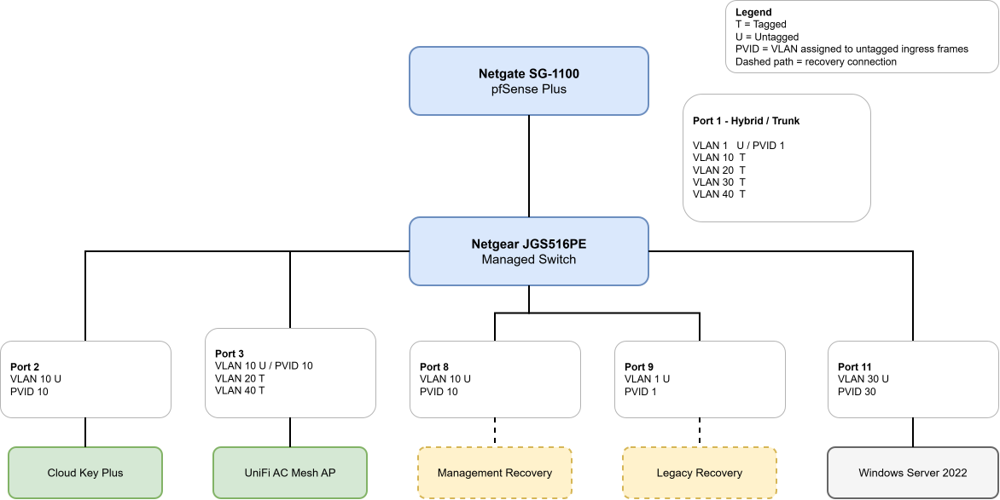

# Switching and VLAN Transport

## Overview

This document describes how VLAN traffic is transported through the physical switching infrastructure.

It covers the Netgate SG-1100 internal switch architecture, the Netgear JGS516PE VLAN configuration model, tagged and untagged membership, PVID behavior, and the role of important switch ports.

The goal is to document how Layer 2 traffic is carried between pfSense, infrastructure devices, wired clients, and the UniFi wireless environment.

## Netgate SG-1100 Internal Switch Architecture

The SG-1100 does not expose each physical Ethernet port as an independent pfSense interface in the same way as a traditional multi-NIC firewall.

Its physical Ethernet ports are connected through an internal switch, and VLAN transport depends on both:

- the VLAN interface configuration in pfSense
- the SG-1100 internal switch VLAN configuration

Creating a VLAN interface in pfSense alone is not sufficient to guarantee that the VLAN is transported through the physical LAN path.

### Internal Port Mapping

The SG-1100 uses internal switch ports to connect the CPU and physical Ethernet interfaces.

For the LAN path used by this network, custom VLANs must be transported between the CPU-facing switch port and the physical LAN-facing switch port.

The relevant membership pattern is:

`0t,2t`

where both ports carry the VLAN as tagged traffic.

### Built-In System VLANs

The SG-1100 includes built-in internal switch VLANs used by the platform.

These include:

| VLAN ID | Role | Internal Membership |
|---|---|---|
| 1 | Default / native switch VLAN | Platform default |
| 4090 | WAN | `0t,3` |
| 4091 | LAN | `0t,2` |
| 4092 | OPT | `0t,1` |

These built-in VLANs are part of the SG-1100 platform architecture and should not be modified as part of normal custom VLAN configuration.

### Custom VLAN Membership

Custom VLANs that are transported through the SG-1100 LAN path require corresponding internal switch VLAN membership.

For this network, custom VLANs such as VLAN 10, VLAN 20, VLAN 30, and VLAN 40 use:

`0t,2t`

This allows tagged VLAN traffic to pass between the SG-1100 CPU and the physical LAN connection.

> [!WARNING]
> Creating a VLAN interface in pfSense is not sufficient on the SG-1100.  
> Custom VLANs carried through the LAN path must also be configured in the SG-1100 internal switch with the required tagged membership.

## Netgear JGS516PE

The Netgear JGS516PE provides the primary Layer 2 switching fabric for the network.

The switch carries both tagged and untagged VLAN traffic depending on the role of each port.

### VLAN Membership Terminology

The switch uses three important concepts:

- **Tagged membership** - Ethernet frames for the VLAN leave the port with an IEEE 802.1Q VLAN tag.
- **Untagged membership** - Ethernet frames for the VLAN leave the port without a VLAN tag.
- **PVID** - The Port VLAN ID assigned to untagged frames when they enter the switch.

A port can carry multiple tagged VLANs, but an access device normally uses one untagged VLAN with a matching PVID.

The following diagram provides a visual summary of VLAN transport, tagging, and access-port behavior.

  

### Port Role Summary

| Port | Role | VLAN Behavior |
|---|---|---|
| 1 | pfSense uplink | VLAN 1 untagged; VLANs 10, 20, 30, and 40 tagged |
| 2 | UniFi Cloud Key Plus | VLAN 10 untagged |
| 3 | UniFi AC Mesh AP | VLAN 10 untagged; VLANs 20 and 40 tagged |
| 7 | Guest diagnostic port | VLAN 40 untagged |
| 8 | Management recovery port | VLAN 10 untagged |
| 9 | Legacy recovery port | VLAN 1 untagged |
| 11 | Windows Server 2022 | VLAN 30 untagged |

### VLAN Membership Matrix

| Port | VLAN 1 | VLAN 10 | VLAN 20 | VLAN 30 | VLAN 40 |
|---|---|---|---|---|---|
| 1 - pfSense uplink | Untagged | Tagged | Tagged | Tagged | Tagged |
| 2 - Cloud Key | - | Untagged | - | - | - |
| 3 - UniFi AP | - | Untagged | Tagged | - | Tagged |
| 7 - Guest diagnostic | - | - | - | - | Untagged |
| 8 - Management recovery | - | Untagged | - | - | - |
| 9 - Legacy recovery | Untagged | - | - | - | - |
| 11 - Windows Server | - | - | - | Untagged | - |

### PVID Matrix

| Port | PVID | Purpose |
|---|---|---|
| 1 | 1 | Untagged traffic belongs to Legacy / Recovery |
| 2 | 10 | Cloud Key management |
| 3 | 10 | Access point management |
| 7 | 40 | Guest diagnostic access |
| 8 | 10 | Management recovery |
| 9 | 1 | Legacy break-glass recovery |
| 11 | 30 | Windows Server |

## Important Port Notes

### Port 1 - pfSense Uplink

Port 1 connects the Netgear switch to the SG-1100 LAN path.

It carries:

- VLAN 1 untagged
- VLAN 10 tagged
- VLAN 20 tagged
- VLAN 30 tagged
- VLAN 40 tagged

Its PVID is `1`.

This port is critical because it carries the Layer 2 path for all active VLANs between the switch and pfSense.

Changes to this port can affect multiple network segments at once and should be made only when a recovery path is available.

### Port 2 - UniFi Cloud Key Plus

Port 2 connects the UniFi Cloud Key Plus.

It uses VLAN 10 untagged with PVID `10`.

The Cloud Key resides on the Management VLAN and provides UniFi controller services, including management of the access point and support for the Guest captive portal.

Because Guest portal functionality depends on reaching the Cloud Key, stable addressing and continued Management VLAN connectivity are operationally important.

### Port 3 - UniFi Access Point

Port 3 connects the UniFi AC Mesh access point.

It carries:

- VLAN 10 untagged for access point management
- VLAN 20 tagged for Trusted wireless clients
- VLAN 40 tagged for Guest wireless clients

Its PVID is `10`.

This is a hybrid port because it carries one untagged VLAN and multiple tagged VLANs over the same physical connection.

### Port 7 - Guest Diagnostic Port

Port 7 provides temporary wired access to VLAN 40.

It uses VLAN 40 untagged with PVID `40`.

This port is useful for testing the Guest VLAN independently from the wireless access point.

A wired test on this port can help distinguish between:

- VLAN transport problems
- pfSense routing or firewall problems
- UniFi wireless configuration problems

### Port 8 - Management Recovery Port

Port 8 provides dedicated wired access to the Management VLAN.

It uses VLAN 10 untagged with PVID `10`.

This port is intended for controlled administrative recovery and provides a direct Layer 2 path into the Management network.

### Port 9 - Legacy Recovery Port

Port 9 provides break-glass access to the Legacy / Recovery VLAN.

It uses VLAN 1 untagged with PVID `1`.

Because the Legacy / Recovery network is intentionally privileged, this port should remain dedicated to emergency recovery use.

### Port 11 - Windows Server

Port 11 connects the Windows Server 2022 system.

It uses VLAN 30 untagged with PVID `30`.

The server does not need to understand VLAN tagging because the switch presents VLAN 30 to the endpoint as ordinary untagged Ethernet traffic.

## Layer-2 Safety Notes

The switching configuration contains several settings that are operationally critical.

- Do not modify the SG-1100 built-in VLANs `4090`, `4091`, or `4092` as part of normal custom VLAN work.
- Custom VLANs transported through the SG-1100 LAN path require the correct internal switch membership.
- Avoid creating Layer 2 loops between switch ports.
- The SG-1100 internal switch does not provide the same loop-prevention behavior as a managed switch using Spanning Tree Protocol.
- Preserve known-good recovery access before changing trunk, hybrid, or management ports.
- Changes to port 1 or port 3 can affect multiple VLANs simultaneously.
- Test VLAN behavior with a simple wired access port when troubleshooting whenever possible.

